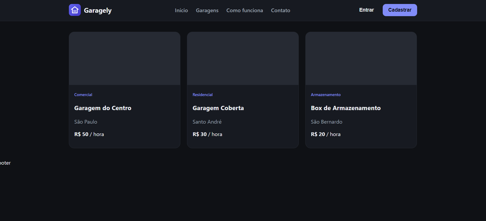
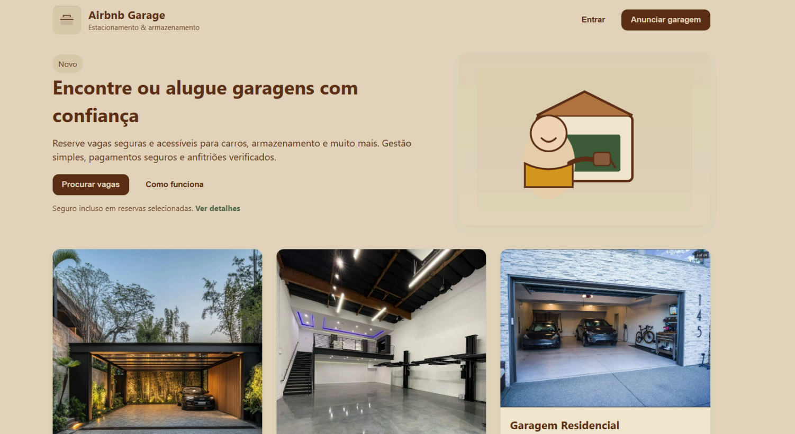

<h1 align="center">Garagely</h1>

<p align="center">
  Plataforma de aluguel de garagens e espaços de armazenamento.
</p>

<p align="center">
  
  
  
</p>




## Sobre

O Garagely nasceu como um protótipo em HTML e CSS (pasta `legacy`) e está
sendo reconstruído como aplicação full stack, para praticar front-end,
API e banco de dados. O projeto se iniciou no segundo semestre do meu curso Técnico em Desenvolvimento de Sistemas como um "Airbnb Garage" e, hoje, está em desenvolvimento para um projeto autoral.

## Funcionalidades

- [ ] Layout responsivo com modo claro e escuro
- [x] Header com menu de navegação
- [x] Grade de cards de garagens
- [ ] Busca por nome e cidade
- [ ] API com Node.js e Express
- [ ] Banco de dados PostgreSQL com Prisma
- [ ] Login e cadastro (JWT)
- [ ] Cadastro de garagens
- [ ] Deploy

## Tecnologias

- **Front-end:** React, Vite, CSS
- **Planejado:** Node.js, Express, PostgreSQL, Prisma

## Como rodar

```bash
git clone https://github.com/adrianadamore/Garagely.git
cd Garagely/client
npm install
npm run dev
```

Abra o endereço mostrado no terminal (normalmente http://localhost:5173).

## Estrutura

```
Garagely/
├── client/    # front-end em React
└── legacy/    # primeira versão em HTML e CSS
```

## O que estou praticando

Componentes e props, `useState`, listas com `map`, filtros com `filter`
e organização de pastas.

## Autora

**Adriana Valentina D'Amore**
[LinkedIn](https://www.linkedin.com/in/adriana-valentina-damore) ·
[GitHub](https://github.com/adrianadamore)